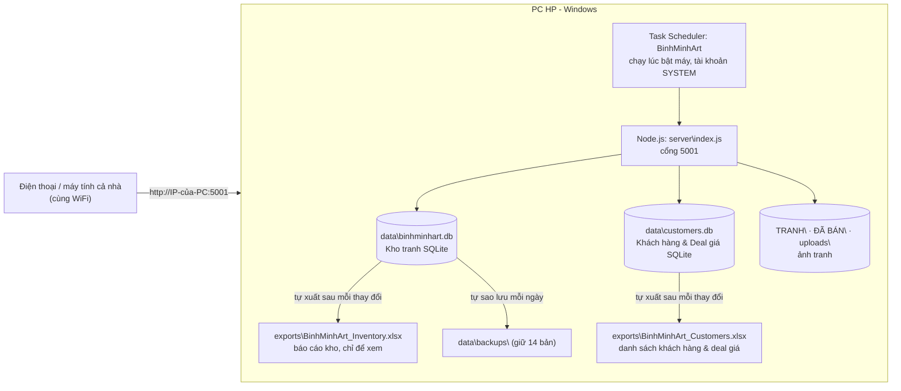

# BIÊN BẢN BÀN GIAO CẤU HÌNH HỆ THỐNG (CẤU HÌNH THỦ CÔNG)

- **Hệ thống:** Bình Minh Art Gallery Dashboard - quản lý kho tranh (phiên bản ứng dụng `1.0.0`, cơ sở dữ liệu schema v1)
- **Máy nhận bàn giao:** PC HP (máy chủ chạy 24/7 trong nhà), hệ điều hành Windows
- **Hình thức:** cấu hình **thủ công từng bước**, không dùng script `install.ps1` (bảng đối chiếu ở Phần 10)

> **Cách dùng tài liệu này:** làm lần lượt từng bước ở Phần 4. Mỗi bước có ô tick `☐` (đánh dấu `☑` khi xong), cột **Kết quả mong đợi** để đối chiếu, và ô **Giá trị thực tế** để ghi lại. Phần 6 là nghiệm thu. Không bỏ qua bước nào, và không chuyển sang bước sau khi bước trước chưa đạt kết quả mong đợi.

---

## PHẦN 1. TÓM TẮT HỆ THỐNG ĐƯỢC BÀN GIAO



| Thành phần | Mô tả |
|---|---|
| Ứng dụng | Web app (React) + máy chủ Node.js (Express), một cổng duy nhất **TCP 5001** với 4 chế độ xem: **Quản Lý Kho (Excel)**, **Quản Lý Khách Hàng (CRM)**, **Bảng Giá & Xuất PDF**, **Triển Lãm Cho Khách** (chuyển đổi qua 1 nút dropdown tiện lợi trên thanh Header) |
| Dữ liệu kho tranh gốc | SQLite: `data\binhminhart.db`. Ghi theo giao dịch, kiểm tra kiểu dữ liệu, không tự sửa dữ liệu sai |
| Dữ liệu khách hàng gốc | SQLite: `data\customers.db` (tách biệt hoàn toàn). Quản lý họ tên, số điện thoại, lịch hẹn, ghi chú, và danh sách tranh quan tâm kèm cột **Giá deal** |
| Báo cáo Excel kho tranh | `exports\BinhMinhArt_Inventory.xlsx`, tự tạo lại sau mỗi thay đổi kho tranh |
| Báo cáo Excel khách hàng | `exports\BinhMinhArt_Customers.xlsx`, tự tạo lại gồm 2 sheet: "DANH SÁCH KHÁCH HÀNG" và "TRANH QUAN TÂM & DEAL GIÁ" |
| Sao lưu | Tự động mỗi ngày vào `data\backups\` (giữ 14 bản), cộng một bản trước mỗi lần "Phục Hồi Gốc" |
| Mã QR | Mỗi tranh có mã QR chứa địa chỉ `http://<IP-của-PC>:5001/tranh/<Mã-tranh>`, nên **IP của PC phải cố định** |
| Đăng nhập | **Chưa có.** Ai vào được địa chỉ đều xem và sửa được dữ liệu (xem Phần 9) |

### Hiện trạng dữ liệu tại thời điểm bàn giao (từ cơ sở dữ liệu trên máy Mac, 25/10/2026)

| Chỉ số | Giá trị |
|---|---|
| Tổng số tác phẩm kho | 14 |
| Chưa bán | 13 (giá trị niêm yết 66.400 USD) |
| Đã bán | 1 (`DVS-SM-02`, khách "Chị Hạnh (Đức)", 1.800 USD) |
| Chưa có giá (thỏa thuận) | 2 (`DVS-SD-04`, `DVS-SD-05`) |
| Phân hệ Quản lý Khách hàng | Đã khởi tạo CSDL `data\customers.db` riêng biệt, hỗ trợ tạo nhanh, queue chọn tranh & deal giá, bộ đếm lịch hẹn hôm nay/sắp tới |
| Kiểm tra toàn vẹn CSDL (`integrity_check`) | `ok` (cả `binhminhart.db` và `customers.db`) |

Sau khi bàn giao, hai bản dữ liệu (Mac và PC) là hai bản **độc lập**. Mọi chỉnh sửa thật phải làm trên PC.

---

## PHẦN 2. DANH MỤC BÀN GIAO

| # | Hạng mục | Chi tiết | Bên A giao ☐ | Bên B nhận ☐ |
|---|---|---|---|---|
| 1 | Gói cài đặt | `BinhMinhArt_transfer_20261024.zip`, 291.377.515 byte (khoảng 278 MiB), 333 tệp | ☐ | ☐ |
| 2 | Mã băm SHA-256 của gói | `03679d851a750ab08a78d85808a54d1280d5d69b178bca1fa4786c54a37d9a03` | ☐ | ☐ |
| 3 | Tài liệu này (bản in hoặc PDF, bàn giao **riêng**, không nằm trong gói zip để mã băm của gói không bị đổi) | `docs\BIEN-BAN-BAN-GIAO-CAU-HINH-THU-CONG.md` | ☐ | ☐ |
| 4 | Hướng dẫn triển khai tóm tắt | `docs\DEPLOY-WINDOWS.md` | ☐ | ☐ |
| 5 | Script tham chiếu (không bắt buộc dùng) | `deploy\windows\install.ps1`, `uninstall.ps1`, `run_server.bat` | ☐ | ☐ |
| 6 | Mã nguồn đầy đủ | thư mục `server\`, `src\`, `public\`, cấu hình Vite/Tailwind, `package.json`, `package-lock.json` | ☐ | ☐ |
| 7 | Cơ sở dữ liệu | `data\binhminhart.db` (14 tác phẩm, bản chụp nhất quán, không kèm `-wal`/`-shm`) | ☐ | ☐ |
| 8 | Ảnh tranh | `TRANH\` (13 tệp), `ĐÃ BÁN\` (1 tệp), `uploads\`, `thumbnails\` | ☐ | ☐ |
| 9 | Tệp Word nguồn bảng giá | `BẢNG GIÁ.docx` (dùng cho chức năng "Nạp loạt dữ liệu") | ☐ | ☐ |

> **Lưu ý:** các số liệu của gói (kích thước, số tệp, mã băm) chỉ đúng với gói tạo lúc 24/10/2026 11:25. Nếu đóng gói lại bằng `python3 scripts/make_transfer_package.py` thì thư mục `docs\` (có thể cả tài liệu này) và dữ liệu sẽ thay đổi, khi đó phải cập nhật lại các dòng 1, 2 của bảng trên, số tệp ở B4 và mã băm ở B3, Phần 5.

**Không có trong gói (PC tự tạo lại):** `node_modules\`, `dist\`, `logs\`, `exports\`, mã QR cũ (`thumbnails\qr\`), `data\network_config.json` (chứa IP của máy Mac), `data\backups\`, `data\legacy\`.

**Tài khoản / mật khẩu / khóa bí mật bàn giao:** không có. Hệ thống không dùng tài khoản, không có tệp `.env`, không có khóa API.

---

## PHẦN 3. YÊU CẦU VỚI MÁY NHẬN

| Hạng mục | Yêu cầu | Giá trị thực tế |
|---|---|---|
| Hệ điều hành | Windows 11 (ưu tiên) hoặc Windows 10. Windows 10 đã hết hỗ trợ cập nhật bảo mật từ 14/10/2025 | ______________ |
| Tài khoản thực hiện | Quản trị viên (Administrator) | ______________ |
| RAM | Khuyến nghị từ 4 GB | ______ GB |
| Ổ đĩa trống | Khuyến nghị từ 5 GB (gói giải nén khoảng 0,3 GB, thư viện khoảng 0,16 GB, cộng chỗ cho ảnh và sao lưu) | ______ GB |
| Mạng | Cắm dây mạng (LAN) vào router nhà, cùng mạng với điện thoại cả nhà. Cần Internet trong lúc cài thư viện (bước B5) | ______________ |
| Phần mềm | Node.js LTS **từ 22.13 trở lên** (cài ở bước B2) | ______________ |
| Điện | Cắm điện lưới, khuyến nghị có UPS nhỏ để tránh hỏng dữ liệu khi mất điện đột ngột | ☐ có UPS  ☐ không |

---

## PHẦN 4. CẤU HÌNH THỦ CÔNG TỪNG BƯỚC

Mở **Windows PowerShell bằng quyền Administrator** cho các lệnh bên dưới: bấm Start, gõ `PowerShell`, bấm chuột phải, chọn **Run as administrator**. Dấu `>` ở đầu dòng là dấu nhắc lệnh, không gõ.

### B0. Ghi lại thông tin máy trước khi thay đổi

| ☐ | Mục | Cách lấy | Giá trị thực tế |
|---|---|---|---|
| ☐ | Tên máy | `> hostname` | ______________ |
| ☐ | Phiên bản Windows | `> winver` (hoặc Settings → System → About) | ______________ |
| ☐ | Địa chỉ MAC card mạng | `> ipconfig /all` → dòng *Physical Address* của card đang dùng | ______________ |
| ☐ | IP hiện tại, Gateway, DNS | `> ipconfig /all` | ______ / ______ / ______ |
| ☐ | Thời gian ngủ màn hình / máy (khi cắm điện) **trước khi đổi** | Settings → System → Power & battery → Screen and sleep | ______ phút / ______ phút |

### B1. Múi giờ và đồng hồ

**Mục đích:** ngày ghi trong hệ thống (`dd-mm-yyyy`, ví dụ ngày cập nhật giá, ngày bán) lấy theo **giờ của PC**. Sai múi giờ thì có thể ghi lệch ngày.

| ☐ | Thao tác | Kết quả mong đợi |
|---|---|---|
| ☐ | Settings → Time & language → Date & time. Bật *Set time automatically*, chọn múi giờ **(UTC+07:00) Bangkok, Hanoi, Jakarta**, bấm *Sync now* | Giờ khớp với điện thoại |
| ☐ | Kiểm tra bằng lệnh `> tzutil /g` | In ra `SE Asia Standard Time` |

Nếu sai, đặt bằng lệnh `> tzutil /s "SE Asia Standard Time"`. Giá trị thực tế: ______________

### B2. Cài Node.js

| ☐ | Thao tác | Kết quả mong đợi |
|---|---|---|
| ☐ | Cách 1: `> winget install OpenJS.NodeJS.LTS`. Cách 2: tải bản **LTS** (`.msi`) từ <https://nodejs.org>, chạy, giữ nguyên các tùy chọn mặc định (đảm bảo mục *Add to PATH* được bật). **Không** cần tick mục "Automatically install the necessary tools" | Cài xong không báo lỗi |
| ☐ | **Đóng PowerShell, mở PowerShell Administrator mới** (để nhận PATH mới), gõ `> node -v` | Từ `v22.13.0` trở lên |
| ☐ | `> npm -v` | In ra số phiên bản (ví dụ `10.x`) |

Giá trị thực tế: node ______________  npm ______________

### B3. Chép gói cài đặt và kiểm tra toàn vẹn

| ☐ | Thao tác | Kết quả mong đợi |
|---|---|---|
| ☐ | Chép `BinhMinhArt_transfer_20261024.zip` từ USB vào ổ đĩa của PC (ví dụ `C:\Temp\`). Không cần chép từ kênh công cộng, vì gói chứa giá và tên khách hàng | Tệp 291.377.515 byte |
| ☐ | `> Get-FileHash C:\Temp\BinhMinhArt_transfer_20261024.zip -Algorithm SHA256` | Cột *Hash* **trùng khớp** `03679d85…d9a03` ở Phần 2 (không phân biệt hoa thường). Nếu không khớp, **dừng lại**, chép lại tệp |

Giá trị thực tế (6 ký tự đầu và cuối): ____________ … ____________

### B4. Giải nén vào thư mục cố định

**Quy tắc chọn thư mục:** dùng `C:\BinhMinhArt`. **Không** đặt trong Desktop, Documents, Downloads hoặc bất kỳ thư mục nào được **OneDrive** đồng bộ, vì OneDrive có thể khóa tệp cơ sở dữ liệu và làm hỏng việc ghi.

| ☐ | Thao tác | Kết quả mong đợi |
|---|---|---|
| ☐ | Giải nén zip vào `C:\BinhMinhArt` (Windows 11: chuột phải → *Extract All*; Windows 10 hiện tên tiếng Việt bị lỗi font thì dùng **7-Zip**) | Có các thư mục `server`, `src`, `data`, `TRANH`, `ĐÃ BÁN`, `uploads`, `deploy`, `docs` |
| ☐ | Kiểm tra số tệp: `> (Get-ChildItem C:\BinhMinhArt -Recurse -File \| Measure-Object).Count` | **333** |
| ☐ | Kiểm tra tên thư mục `ĐÃ BÁN` và tên ảnh trong `TRANH` hiển thị đúng dấu tiếng Việt | Không có ký tự lạ như `?` hay `Ä` |
| ☐ | Kiểm tra có tệp `C:\BinhMinhArt\data\binhminhart.db` (dung lượng khoảng 28 KB) | Có |

Giá trị thực tế: số tệp ______  thư mục cài ______________

### B5. Cài thư viện (cần Internet)

```powershell
> cd C:\BinhMinhArt
> npm ci
```

| ☐ | Kết quả mong đợi | Nếu lỗi |
|---|---|---|
| ☐ | Kết thúc với dòng `added … packages`, không có chữ `ERR!`. Có thể có cảnh báo `deprecated`, `vulnerabilities` (bình thường, không dừng lại vì chúng) | Xem Phần 8, mục "npm ci lỗi" |

Lưu ý: thư viện `xlsx` được tải từ `cdn.sheetjs.com`, nên mạng không được chặn địa chỉ này. Không dùng `npm ci --omit=dev` (thư viện tạo ảnh thu nhỏ `sharp` nằm trong nhóm dev). Giá trị thực tế (số gói): ______

### B6. Biên dịch giao diện

```powershell
> npm run build
```

| ☐ | Kết quả mong đợi |
|---|---|
| ☐ | Có dòng `✓ built in …s` và tồn tại tệp `C:\BinhMinhArt\dist\index.html` |

### B7. Chạy thử thủ công (chạy ở cửa sổ, chưa tự động)

```powershell
> node server\index.js
```

| ☐ | Kết quả mong đợi |
|---|---|
| ☐ | Cửa sổ in lần lượt: `[BinhMinhArt Server] Running on http://localhost:5001`, `[DB Backup] Created binhminhart-…-auto.db`, `[DB] SQLite database ready (14 paintings): C:\BinhMinhArt\data\binhminhart.db`, `[BinhMinhArt Server] Database & Thumbnails ready.` Có thêm dòng `ExperimentalWarning: SQLite is an experimental feature` là **bình thường** |
| ☐ | Windows có thể hiện hộp thoại *Windows Defender Firewall has blocked some features of Node.js*: chọn **Allow access** (cho cả mạng Private và Public). Nếu đã làm bước B8 trước thì không hiện |
| ☐ | Mở trình duyệt trên chính PC, vào `http://localhost:5001` | Thấy giao diện Bình Minh Art Gallery, bảng có 13 tranh *Chưa bán*, thẻ "Đã giao dịch: 1" |
| ☐ | Sau vài giây tồn tại `C:\BinhMinhArt\exports\BinhMinhArt_Inventory.xlsx` và thư mục `C:\BinhMinhArt\data\backups\` có một tệp `.db` | Có |

Dừng bằng **Ctrl + C** trong cửa sổ PowerShell. Không đóng cửa sổ bằng cách tắt đột ngột.

### B8. Mở cổng tường lửa (TCP 5001)

**Cách giao diện:** Start → gõ `Windows Defender Firewall with Advanced Security` (hoặc chạy `wf.msc`) → *Inbound Rules* → *New Rule…*

| Bước trong trình hướng dẫn | Chọn |
|---|---|
| Rule Type | **Port** |
| Protocol and Ports | **TCP**, *Specific local ports*: `5001` |
| Action | **Allow the connection** |
| Profile | tick cả **Domain, Private, Public** |
| Name | `BinhMinhArt (TCP 5001)` |

| ☐ | Kiểm tra | Kết quả mong đợi |
|---|---|---|
| ☐ | `> Get-NetFirewallRule -DisplayName "BinhMinhArt (TCP 5001)" \| Format-List DisplayName,Enabled,Direction,Action,Profile` | `Enabled: True`, `Direction: Inbound`, `Action: Allow`, `Profile: Any` |

Ghi chú: PC đặt cố định ở nhà nên mở cả ba loại mạng. Nếu mang máy ra mạng lạ, **xóa rule này** (xem Phần 7.5).

### B9. Cấu hình nguồn điện: không cho máy ngủ

| ☐ | Thao tác | Kết quả mong đợi |
|---|---|---|
| ☐ | Settings → System → Power & battery → Screen and sleep: mục *When plugged in, put my device to sleep after* = **Never**. (Tắt màn hình thì tùy ý) | Đã đặt |
| ☐ | Hoặc dùng lệnh: `> powercfg /change standby-timeout-ac 0` và `> powercfg /change hibernate-timeout-ac 0` | Không báo lỗi |
| ☐ | Windows Update: Settings → Windows Update → Advanced options → *Active hours* đặt khung giờ cả nhà hay dùng (ví dụ 07:00 - 23:00). Máy tự khởi động lại khi cập nhật, và server **tự chạy lại** sau khi khởi động | Đã đặt |
| ☐ | (Khuyến nghị) BIOS/UEFI của máy HP: bấm **F10** lúc bật máy → tìm mục *After Power Loss* (thường nằm ở *Advanced → Power-On Options*) đặt **Power On**. Tên mục có thể khác theo model | ☐ đã đặt  ☐ model không có |

### B10. Tạo tác vụ tự chạy khi bật máy (Task Scheduler)

Start → gõ `Task Scheduler` → *Action → Create Task…* (**không** chọn *Create Basic Task*). Điền từng thẻ như sau:

**Thẻ General**

| Trường | Giá trị |
|---|---|
| Name | `BinhMinhArt` |
| Description | `Binh Minh Art Gallery dashboard server (auto-start at boot)` |
| Security options → *Change User or Group…* | gõ `SYSTEM` → *Check Names* → OK |
| Run whether user is logged on or not | **chọn** (tự chọn khi dùng SYSTEM) |
| Run with highest privileges | **tick** |
| Configure for | Windows 10 / Windows 11 |

**Thẻ Triggers** → *New…*: Begin the task = **At startup**; *Enabled* tick; không đặt delay. OK.

**Thẻ Actions** → *New…*:

| Trường | Giá trị |
|---|---|
| Action | Start a program |
| Program/script | `cmd.exe` |
| Add arguments | `/c ""C:\BinhMinhArt\deploy\windows\run_server.bat""` (đúng **hai** dấu nháy kép ở mỗi đầu) |
| Start in | `C:\BinhMinhArt` |

**Thẻ Conditions:** bỏ tick *Start the task only if the computer is on AC power*; bỏ tick *Stop if the computer switches to battery power*; bỏ tick *Wake the computer to run this task*.

**Thẻ Settings:**

| Tùy chọn | Giá trị |
|---|---|
| Allow task to be run on demand | tick |
| Run task as soon as possible after a scheduled start is missed | tick |
| If the task fails, restart every | **1 minute**, *Attempt to restart up to* **999** times |
| Stop the task if it runs longer than | **bỏ tick** (chạy vô hạn) |
| If the task is already running, then the following rule applies | **Do not start a new instance** |

Bấm OK. Nhập mật khẩu nếu hỏi (với SYSTEM thì không hỏi).

| ☐ | Kiểm tra | Kết quả mong đợi |
|---|---|---|
| ☐ | Trong Task Scheduler Library bấm chuột phải tác vụ `BinhMinhArt` → **Run**. Chờ 10 giây, mở `http://localhost:5001` | Vào được |
| ☐ | `> Get-ScheduledTask -TaskName BinhMinhArt \| Get-ScheduledTaskInfo` | `LastTaskResult : 267009` (`0x41301` = đang chạy) |
| ☐ | `> netstat -ano \| findstr :5001` | Có dòng `0.0.0.0:5001 … LISTENING` |
| ☐ | Tệp `C:\BinhMinhArt\logs\server.log` được tạo, có dòng `Starting BinhMinhArt` và `Running on http://localhost:5001` | Có |

### B11. IP cố định cho PC (bắt buộc)

**Lý do:** mã QR dán trên tranh chứa địa chỉ IP của PC. IP đổi thì mọi tờ QR đã in sẽ **hỏng**.

**Cách 1 (khuyến nghị): giữ chỗ DHCP trên router** (tên mục tùy hãng: *DHCP Reservation*, *Address Reservation*, *Static DHCP*, *Gán IP theo MAC*)

| ☐ | Thao tác |
|---|---|
| ☐ | Vào trang quản trị router (thường `http://192.168.0.1` hoặc `http://192.168.1.1`, tài khoản in ở mặt dưới router) |
| ☐ | Tìm mục giữ chỗ DHCP, thêm: MAC của PC (ghi ở B0) → IP mong muốn nằm trong dải mạng nhà |
| ☐ | Lưu, rồi khởi động lại card mạng của PC (rút/cắm dây mạng) hoặc khởi động lại PC |
| ☐ | Kiểm tra `> ipconfig` → IP đúng bằng IP đã giữ chỗ |

**Cách 2: đặt IP tĩnh ngay trên Windows** (chỉ dùng nếu router không có giữ chỗ DHCP): Settings → Network & internet → Ethernet → *IP assignment: Edit* → **Manual** → IPv4 bật → nhập IP **nằm ngoài dải DHCP của router**, *Subnet prefix length* `24`, Gateway = IP router, DNS = IP router hoặc `8.8.8.8`.

| Thông số ghi lại | Giá trị thực tế |
|---|---|
| Phương án chọn | ☐ Cách 1  ☐ Cách 2 |
| Hãng/model router | ______________ |
| Địa chỉ MAC của PC | ______________ |
| **IP cố định của PC** | ______ . ______ . ______ . ______ |
| Gateway / DNS | ______________ / ______________ |

### B12. Kiểm tra IP mạng LAN & cấu hình tùy chọn (mã QR tự động nhận diện IP)

> **Cơ chế tự động hóa**: Hệ thống máy chủ đã tích hợp bộ dò tự động (`server/network.js`). Khi máy chủ khởi động, nó tự động phát hiện IP mạng LAN vật lý của PC (lọc bỏ các card mạng ảo WSL/Docker/VPN) và tự động tạo mã QR chứa link LAN (ví dụ `http://192.168.0.x:5001/tranh/...`). Vì vậy, người dùng quét mã QR bằng điện thoại sẽ vào được ngay lập tức mà không bắt buộc phải cấu hình thủ công. Bước B12 dưới đây dùng để xác nhận hoặc gán IP cố định tùy chỉnh nếu mạng có nhiều card mạng.

| ☐ | Thao tác | Kết quả mong đợi |
|---|---|---|
| ☐ | Mở `http://localhost:5001`, bấm nút **IP WiFi / DB** trên thanh đầu trang | Hiện cửa sổ cài đặt: phần *Cơ Sở Dữ Liệu Gốc (SQLite)* hiện `14 tác phẩm`, mục *IP Tự Động Nhận Diện* hiển thị đúng IP LAN của PC |
| ☐ | (Tùy chọn khi cần cố định) Nhập IP cố định ở B11 (hoặc bấm vào gợi ý IP) → bấm **Lưu Cấu Hình IP** | Thông báo đã lưu, tệp `data\network_config.json` được ghi nhận |
| ☐ | Kiểm tra mã QR trên màn hình hoặc tệp trong `C:\BinhMinhArt\thumbnails\qr\` | Link mã QR tự động mang địa chỉ IP mạng LAN thật thay vì localhost |

### B13. Kiểm tra truy cập từ thiết bị khác

| ☐ | Thao tác | Kết quả mong đợi |
|---|---|---|
| ☐ | Điện thoại nối **cùng WiFi nhà** (không dùng WiFi khách/guest, không dùng 4G), mở `http://<IP-của-PC>:5001` | Thấy giao diện, đủ 13 tranh |
| ☐ | Dùng camera quét mã QR của một tranh (trong cột *Mã QR* của bảng, hoặc mở tệp ảnh trong `thumbnails\qr\`) | Mở đúng trang chi tiết `…/tranh/<Mã-tranh>` |

### B14. Kiểm thử khởi động lại (quan trọng nhất)

| ☐ | Thao tác | Kết quả mong đợi |
|---|---|---|
| ☐ | Khởi động lại PC (Start → Power → Restart). **Không đăng nhập Windows** (để ở màn hình khóa). Chờ 3 phút | PC lên bình thường |
| ☐ | Từ điện thoại mở `http://<IP-của-PC>:5001` | Vào được mà **không cần ai đăng nhập vào PC** |

Nếu máy dùng BitLocker có mã PIN lúc khởi động thì server chỉ chạy sau khi mở khóa. Ghi chú: ______________

### B15. Kiểm thử mất điện (tùy chọn, chỉ làm nếu đã đặt BIOS ở B9)

| ☐ | Thao tác | Kết quả mong đợi |
|---|---|---|
| ☐ | Tắt PC sạch (Shut down), **rút nguồn** 10 giây rồi cắm lại | Máy tự bật |
| ☐ | Sau 3 phút, mở `http://<IP-của-PC>:5001` từ điện thoại | Vào được, dữ liệu nguyên vẹn |

### B16. Thiết lập sao lưu ra ngoài (mỗi tuần)

Bản sao lưu tự động nằm cùng ổ đĩa, nên **không an toàn nếu ổ cứng hỏng**. Mỗi tuần chép ra ổ ngoài hoặc USB (ví dụ ổ `E:`), mở PowerShell:

```powershell
> robocopy "C:\BinhMinhArt\data\backups" "E:\BinhMinhArt_Backup\backups" /E
> robocopy "C:\BinhMinhArt\uploads"      "E:\BinhMinhArt_Backup\uploads"      /E
> robocopy "C:\BinhMinhArt\TRANH"        "E:\BinhMinhArt_Backup\TRANH"        /E
> robocopy "C:\BinhMinhArt\ĐÃ BÁN"       "E:\BinhMinhArt_Backup\ĐÃ BÁN"       /E
```

`robocopy` trả mã thoát 0-7 là thành công (không phải lỗi). **Không** chép trực tiếp `data\binhminhart.db` khi server đang chạy; lấy tệp trong `data\backups\`.

| ☐ | Mục | Giá trị thực tế |
|---|---|---|
| ☐ | Ổ lưu sao lưu | ______________ |
| ☐ | Người chịu trách nhiệm sao lưu hằng tuần | ______________ |
| ☐ | Ngày sao lưu ra ngoài đầu tiên | ____/____/________ |

---

## PHẦN 5. BẢNG THÔNG SỐ CẤU HÌNH TỔNG HỢP

| Thông số | Giá trị chuẩn | Giá trị thực tế |
|---|---|---|
| Thư mục cài đặt | `C:\BinhMinhArt` | ______________ |
| Cổng | `5001` (TCP) | ______________ |
| Địa chỉ truy cập trên PC | `http://localhost:5001` | ______________ |
| Địa chỉ cho cả nhà | `http://<IP-cố-định>:5001` | ______________ |
| Cơ sở dữ liệu | `C:\BinhMinhArt\data\binhminhart.db` | ______________ |
| Thư mục sao lưu tự động | `C:\BinhMinhArt\data\backups\` (14 bản) | ______________ |
| Báo cáo Excel | `C:\BinhMinhArt\exports\BinhMinhArt_Inventory.xlsx` | ______________ |
| Tệp nhật ký | `C:\BinhMinhArt\logs\server.log` (quay vòng ở 5 MB thành `server.old.log`) | ______________ |
| Tệp cấu hình IP của ứng dụng | `C:\BinhMinhArt\data\network_config.json` | ______________ |
| Tác vụ tự chạy | `BinhMinhArt` (At startup, SYSTEM, highest privileges, restart mỗi 1 phút, tối đa 999 lần) | ______________ |
| Quy tắc tường lửa | `BinhMinhArt (TCP 5001)`, Inbound, Allow, Any profile | ______________ |
| Múi giờ | `SE Asia Standard Time` (UTC+07:00) | ______________ |
| Node.js / npm | Node `>= 22.13` | ______________ |
| Mã băm gói cài đặt | `03679d85…d9a03` | ______________ |
| Ngày giờ hoàn tất cấu hình | | ____/____/________ ____:____ |

---

## PHẦN 6. NGHIỆM THU

Ghi **Đạt** hoặc **Không đạt** vào cột kết quả. Chỉ coi là nghiệm thu khi tất cả mục bắt buộc (★) đều Đạt. Thực hiện theo thứ tự T01 → T17.

| Mã | ★ | Hạng mục | Cách kiểm tra | Kết quả mong đợi | Kết quả |
|---|---|---|---|---|---|
| T01 | ★ | Server chạy | Trình duyệt trên PC: `http://localhost:5001` | Thấy giao diện, không báo lỗi | ☐ Đạt ☐ Không |
| T02 | ★ | Dữ liệu đủ | `> (Invoke-RestMethod http://localhost:5001/api/paintings).data.Count` | `14` | ☐ Đạt ☐ Không |
| T03 | ★ | Trạng thái CSDL | `> (Invoke-RestMethod http://localhost:5001/api/network-info).dbStatus \| ConvertTo-Json -Depth 4` | `engine: sqlite`, `paintingCount: 14`, `excelReport.ok: true` | ☐ Đạt ☐ Không |
| T04 | ★ | Thêm tranh thử | Bấm *+ Thêm Lẻ*, tạo tranh tên `TEST-BANGIAO`, giá `100` (điền các trường bắt buộc khác nếu form yêu cầu), lưu. **Tranh thử này dùng cho T05, T06, T08 và được xóa ở T17. Không sửa các tranh thật khi nghiệm thu** | Thấy tranh trong bảng, tổng thành 15 | ☐ Đạt ☐ Không |
| T05 | ★ | Dữ liệu còn sau khởi động lại | Task Scheduler: `BinhMinhArt` → End → Run, chờ 10 giây, tải lại trang | Tranh `TEST-BANGIAO` vẫn còn, tổng vẫn 15 | ☐ Đạt ☐ Không |
| T06 | ★ | Ngày đúng định dạng và múi giờ | Sửa giá của `TEST-BANGIAO` từ 100 thành 150, xem cột *Cập nhật giá* của tranh đó | Ngày hôm nay, dạng `dd-mm-yyyy` | ☐ Đạt ☐ Không |
| T07 | ★ | Báo cáo Excel | Bấm *Tải File Excel (.xlsx)* và mở `exports\BinhMinhArt_Inventory.xlsx` | Mở được, có các sheet `DASHBOARD TỔNG QUAN`, `KHO TRANH`, `ĐÃ BÁN` | ☐ Đạt ☐ Không |
| T08 | ★ | Mở Excel không làm mất dữ liệu | Giữ file `exports\…xlsx` **đang mở** trong Excel. Trong app sửa *Ghi chú* của `TEST-BANGIAO` thành `kiem-tra-khoa-file`, lưu. Sau đó đóng cửa sổ *IP WiFi / DB* và **mở lại** | Sửa thành công và hiện ngay trong bảng. Mở lại cửa sổ *IP WiFi / DB* thấy cảnh báo vàng "Chưa ghi được file Excel". Đóng Excel, chờ tối đa 30 giây, mở lại cửa sổ thì cảnh báo mất và file Excel có chữ `kiem-tra-khoa-file` | ☐ Đạt ☐ Không |
| T09 | ★ | Sao lưu tự động | Xem thư mục `data\backups\` | Có ít nhất 1 tệp `binhminhart-…-auto.db` | ☐ Đạt ☐ Không |
| T10 | ★ | Truy cập từ điện thoại | Điện thoại cùng WiFi mở `http://<IP>:5001` | Vào được | ☐ Đạt ☐ Không |
| T11 | ★ | Mã QR | Quét QR một tranh bằng điện thoại | Mở đúng trang chi tiết tranh đó | ☐ Đạt ☐ Không |
| T12 | ★ | Tự chạy sau khởi động lại | Bước B14 | Vào được khi chưa ai đăng nhập vào PC | ☐ Đạt ☐ Không |
| T13 |  | Hình ảnh | Xem các tranh trong tab *Kho Tranh* (13 tranh thật, cộng tranh thử nếu chưa xóa), bấm vào một ảnh | Ảnh 13 tranh thật hiển thị, phóng to được | ☐ Đạt ☐ Không |
| T14 |  | Tab Đã bán | Mở tab *Đã Bán* | Thấy `DVS-SM-02`, khách "Chị Hạnh (Đức)", giá 1.800 USD | ☐ Đạt ☐ Không |
| T15 |  | Nhật ký | `> Get-Content C:\BinhMinhArt\logs\server.log -Tail 20` | Có dòng khởi động, không có dòng `Error` lặp đi lặp lại | ☐ Đạt ☐ Không |
| T16 |  | Mất điện | Bước B15 (nếu thực hiện) | Máy tự bật, server tự chạy | ☐ Đạt ☐ Không ☐ Bỏ qua |
| T17 | ★ | Dọn dữ liệu thử | Xóa tranh `TEST-BANGIAO` (chạy **sau cùng**, sau T08) | Tổng quay lại **14**, `(Invoke-RestMethod http://localhost:5001/api/paintings).data.Count` = 14 | ☐ Đạt ☐ Không |

Tổng kết: ____ / 13 mục bắt buộc (★) đạt. Kết luận: ☐ Nghiệm thu  ☐ Nghiệm thu có điều kiện (ghi ở Phần 11)  ☐ Không nghiệm thu

---

## PHẦN 7. VẬN HÀNH SAU BÀN GIAO

### 7.1. Dừng / chạy / khởi động lại server

| Việc | Cách làm |
|---|---|
| Dừng | Task Scheduler → chuột phải `BinhMinhArt` → **End** (hoặc `> Stop-ScheduledTask -TaskName BinhMinhArt`) |
| Chạy | Task Scheduler → chuột phải `BinhMinhArt` → **Run** (hoặc `> Start-ScheduledTask -TaskName BinhMinhArt`) |
| Chạy ở cửa sổ để gỡ lỗi | Dừng tác vụ trước, rồi `> C:\BinhMinhArt\deploy\windows\run_server.bat console` (Ctrl+C để dừng) |
| Xem nhật ký trực tiếp | `> Get-Content C:\BinhMinhArt\logs\server.log -Tail 50 -Wait` |

### 7.2. Cập nhật phiên bản mới

1. Dừng tác vụ `BinhMinhArt`.
2. Sao lưu `data\`, `uploads\`, `TRANH\`, `ĐÃ BÁN\` (xem B16).
3. Chép mã mới đè lên `C:\BinhMinhArt`, **giữ nguyên** `data\`, `uploads\`, `TRANH\`, `ĐÃ BÁN\`.
4. `> cd C:\BinhMinhArt`, `> npm ci`, `> npm run build`.
5. Chạy lại tác vụ `BinhMinhArt`, thực hiện lại nghiệm thu T01, T02, T03.

### 7.3. Khôi phục dữ liệu từ bản sao lưu

1. Dừng tác vụ `BinhMinhArt`.
2. Xóa `data\binhminhart.db`, `data\binhminhart.db-wal`, `data\binhminhart.db-shm` (nếu có).
3. Chọn một tệp trong `data\backups\` (tên bắt đầu bằng ngày giờ UTC, ví dụ `binhminhart-2026-10-24T04-23-28-426Z-auto.db`), chép vào `data\` rồi **đổi tên thành** `binhminhart.db`.
4. Chạy lại tác vụ, kiểm tra T02 và T03.

### 7.4. Cập nhật hồ sơ & Thêm tranh trực tiếp vào Database (Thay thế quy trình nạp Excel)

Hệ thống thiết kế theo nguyên tắc SQLite là nguồn dữ liệu gốc duy nhất (SSOT). File `exports\BinhMinhArt_Inventory.xlsx` là bản xuất tự động một chiều từ Database ra để xem hoặc gửi báo cáo. Toàn bộ thao tác cập nhật hoặc thêm mới tranh được thực hiện trực tiếp trên giao diện web và tự động lưu thẳng vào SQLite kèm đồng bộ xuất lại file Excel ngay lập tức:

1. **Cập nhật tranh (Nút "Cập nhật")**:
   - Trên mỗi hàng tranh ở Dashboard, bấm nút **Cập nhật** để mở form chi tiết.
   - Hệ thống tự động nạp toàn bộ thông tin hiện tại của bức tranh lên form.
   - Người dùng có thể sửa bất kỳ trường nào (tên, giá, kích thước, ảnh...) rồi bấm **Lưu Thay Đổi** $\rightarrow$ Hệ thống ghi trực tiếp vào SQLite và tự động tạo lại file Excel báo cáo.

2. **Thêm tranh mới (Nút "+ Thêm Tranh")**:
   - Bấm nút **+ Thêm Tranh** trên thanh đầu trang.
   - Form thêm mới hiển thị đầy đủ các trường thông tin.
   - **Tự động sinh Mã Tranh (ID)**: Hệ thống tự động tính toán mã theo cú pháp: `[Viết tắt Họa Sĩ]-[Viết tắt Chất Liệu]-[Số thứ tự tự tăng]` (ví dụ: `DVS-SM-07`).
   - **Tự động sinh mã QR**: Mã QR cho tranh mới được sinh tự động ngay lập tức chứa IP mạng LAN thật của PC.
   - Bấm **Lưu** $\rightarrow$ Thêm 1 dòng mới vào bảng `paintings` trong SQLite và đồng bộ tức thì lên file Excel.

3. **Quản lý vị trí tranh (`location`) & Nhật ký di chuyển (`location_history`)**:
   - Bảng `paintings` có thêm trường `location` (Vị trí: Kho, Phòng khách, Khu vực 1, Khu vực 2...). Cột này cũng được phản ánh trực tiếp trên Sheet *KHO TRANH* của file Excel.
   - Trong modal chi tiết tranh, có tab riêng **Nhật Ký Vị Trí**: Mỗi lần đổi vị trí tranh, hệ thống tự động ghi lại thời gian, vị trí chuyển đi, vị trí chuyển đến và ghi chú điều chuyển vào bảng `location_history` trong SQLite.

### 7.5. Nút "Phục Hồi Gốc" trong giao diện

Nút này **thay toàn bộ dữ liệu hiện tại** bằng 14 tác phẩm gốc ban đầu. Hệ thống tự tạo bản sao lưu `…-pre-reset.db` trong `data\backups\` trước khi thay. Chỉ dùng khi thật sự cần.

### 7.6. Gỡ cài đặt / hoàn tác cấu hình

| Việc | Cách làm |
|---|---|
| Xóa tác vụ tự chạy | Task Scheduler → chuột phải `BinhMinhArt` → **Delete** |
| Xóa quy tắc tường lửa | `wf.msc` → Inbound Rules → chuột phải `BinhMinhArt (TCP 5001)` → **Delete Rule** |
| Trả lại thời gian ngủ | Settings → Power & battery → đặt lại về giá trị đã ghi ở B0 |
| Gỡ giữ chỗ DHCP / IP tĩnh | Xóa trên router, hoặc đặt lại *IP assignment: Automatic (DHCP)* trên Windows |
| Xóa ứng dụng | Xóa thư mục `C:\BinhMinhArt` **sau khi đã sao lưu** dữ liệu |

---

## PHẦN 8. SỰ CỐ THƯỜNG GẶP

| Triệu chứng | Nguyên nhân thường gặp | Cách xử lý |
|---|---|---|
| `node` không nhận ra lệnh | PowerShell mở trước khi cài Node, PATH chưa cập nhật | Đóng PowerShell, mở cái mới. Nếu vẫn lỗi, cài lại Node và tick *Add to PATH* |
| `npm ci` lỗi `ERR!` | Không có Internet; mạng chặn `cdn.sheetjs.com` hoặc `registry.npmjs.org`; Node quá cũ | Kiểm tra mạng, thử mạng khác (điện thoại phát WiFi). Kiểm tra `node -v` từ 22.13 |
| `npm ci` lỗi liên quan `sharp` | Thiếu gói cài sẵn cho Windows | Chạy lại `npm ci`. Nếu vẫn lỗi, ghi lại nguyên văn thông báo gửi bên A |
| Server báo `EADDRINUSE` (cổng 5001 đã bị dùng) | Server cũ đang chạy hoặc ứng dụng khác chiếm cổng | `> netstat -ano \| findstr :5001` lấy PID cuối dòng, rồi `> tasklist /FI "PID eq <PID>"`. Dừng tác vụ `BinhMinhArt` cũ trước khi chạy tay |
| Dùng được trên PC, điện thoại không vào được | Sai IP; điện thoại ở WiFi khách (client isolation) hoặc dùng 4G; thiếu rule tường lửa; IP PC đã đổi | Kiểm tra `ipconfig`, cùng WiFi nhà, `Get-NetFirewallRule` (B8), `netstat` thấy `0.0.0.0:5001` |
| Sau khởi động lại PC, điện thoại không vào được | Tác vụ chưa chạy, hoặc chạy lỗi | `Get-ScheduledTask -TaskName BinhMinhArt \| Get-ScheduledTaskInfo` xem `LastTaskResult`; đọc `logs\server.log`; kiểm tra thẻ Actions đúng `cmd.exe`, đối số, *Start in* |
| Ảnh tranh không hiện, tên tệp lỗi font | Giải nén bằng công cụ không hỗ trợ UTF-8 | Giải nén lại bằng 7-Zip vào thư mục trống, kiểm tra B4 |
| Ngày ghi sai (lệch ngày) | Sai múi giờ PC | Làm lại B1 |
| Cửa sổ cài đặt hiện cảnh báo vàng "Chưa ghi được file Excel" | `exports\…xlsx` đang mở trong Excel (Windows khóa tệp) | Đóng file Excel đó. Dữ liệu **không mất**, hệ thống tự thử lại mỗi 30 giây |
| Mã QR mở sai địa chỉ (localhost hoặc IP cũ) | Chưa khai báo IP, hoặc đổi IP mà chưa tạo lại QR | Làm lại B12 (nhập IP, End → Run tác vụ). Tờ QR đã in với IP cũ phải in lại |
| Dữ liệu sửa xong không thấy lưu, app báo lỗi đỏ | Dữ liệu sai kiểu bị từ chối (ví dụ giá âm, mã trùng), hoặc ổ đĩa đầy | Đọc nội dung thông báo lỗi, sửa lại dữ liệu; kiểm tra ổ đĩa còn trống |
| Máy tự ngủ làm mất kết nối | Chưa tắt chế độ ngủ | Làm lại B9 |

---

## PHẦN 9. RỦI RO TỒN ĐỌNG VÀ GIỚI HẠN ĐÃ THÔNG BÁO

Bên B xác nhận đã được thông báo và chấp nhận các điểm sau tại thời điểm nhận bàn giao:

| # | Nội dung | Hệ quả | Bên B chấp nhận |
|---|---|---|---|
| 1 | **Chưa có đăng nhập.** Ai vào được địa chỉ đều xem và sửa được dữ liệu (kể cả giá, khách hàng) | Chỉ dùng trong mạng nhà. **Không** mở cổng ra Internet (không port-forward trên router). Có thể bổ sung mã PIN ở phiên bản sau | ☐ |
| 2 | Mã QR gắn với IP của PC | IP đổi thì mọi QR đã in hỏng và phải in lại. Phải cố định IP (B11) | ☐ |
| 3 | Sao lưu tự động nằm cùng ổ đĩa với dữ liệu | Hỏng ổ cứng là mất cả hai. Bên B phải sao lưu ra ngoài mỗi tuần (B16) | ☐ |
| 4 | CSDL dùng SQLite tích hợp sẵn của Node.js, mà Node còn đánh dấu "experimental" | Log có dòng cảnh báo khi khởi động. Phiên bản Node tối thiểu ghi trong `package.json`. Tệp `.db` là SQLite chuẩn; toàn bộ mã SQLite nằm trong `server\sqliteStore.js` nên đổi thư viện sau này chỉ sửa tệp đó | ☐ |
| 5 | Quy trình cài đặt trên Windows được kiểm tra bằng bộ kiểm tra cú pháp và chạy thử trên máy Mac, **chưa chạy thật trên PC Windows này** | Phần 6 (nghiệm thu) là bước xác nhận đầu tiên trên máy thật | ☐ |
| 6 | Hai người sửa **cùng một tranh** cùng lúc thì lần lưu sau ghi đè lần lưu trước (biểu mẫu gửi cả hồ sơ) | Nên thống nhất ai sửa tranh nào | ☐ |
| 7 | Rule tường lửa mở cho mọi loại mạng | Chỉ chấp nhận khi PC đặt cố định ở nhà | ☐ |
| 8 | Chỉ chạy **một** server cho mỗi cơ sở dữ liệu | Không mở `binhminhart.db` bằng hai server cùng lúc | ☐ |

### Dữ liệu chưa đầy đủ tại thời điểm bàn giao (không phải lỗi cấu hình)

- Tranh `DVS-SM-02` đã bán nhưng **chưa có ngày bán** (trường ngày bán đang trống). Cần nhập lại.
- Hai tranh `DVS-SD-04`, `DVS-SD-05` chưa có giá (hiển thị "Thỏa thuận").
- Các trường ngày mua vào, hóa đơn, giấy chứng nhận đang để trống ở hầu hết tranh (hiển thị "Đang cập nhật").

---

## PHẦN 10. ĐỐI CHIẾU VỚI SCRIPT TỰ ĐỘNG (`install.ps1`)

Nếu sau này muốn làm tự động thay cho thủ công, `deploy\windows\install.ps1` thực hiện đúng các bước dưới đây:

| Bước thủ công (tài liệu này) | Bước trong `install.ps1` |
|---|---|
| B2 (kiểm tra Node) | `[1/7] Checking Node.js` (yêu cầu từ 22.13) |
| Dừng tác vụ cũ khi cập nhật | `[2/7] Stopping existing server` |
| B5 | `[3/7] npm ci` |
| B6 | `[4/7] npm run build` |
| B8, B9 (tường lửa, không ngủ) | `[5/7]` (rule `BinhMinhArt (TCP 5001)`, `powercfg` cho `standby` và `hibernate`) |
| B10 | `[6/7] Registering auto-start task` |
| B7, B12 (chạy, kiểm tra, ghi IP vào app nếu máy chỉ có một IP) | `[7/7] Starting server` + kiểm tra `/api/paintings` + gọi `/api/network-info` |
| B1, B3, B4, B11, B13-B16 | **Không có trong script**, luôn làm tay |

Gỡ bằng script: `powershell -ExecutionPolicy Bypass -File .\deploy\windows\uninstall.ps1` (xóa tác vụ và rule tường lửa, không xóa dữ liệu).

---

## PHẦN 11. GHI CHÚ, SAI LỆCH VÀ ĐIỀU KIỆN NGHIỆM THU

Các sai lệch so với tài liệu, lỗi đã gặp và cách xử lý trong lúc cấu hình:

| # | Bước | Nội dung | Cách xử lý | Người ghi |
|---|---|---|---|---|
| 1 | | | | |
| 2 | | | | |
| 3 | | | | |
| 4 | | | | |

Điều kiện kèm theo (nếu nghiệm thu có điều kiện): ______________________________________________

Hạn hoàn thành điều kiện: ____/____/________  Người chịu trách nhiệm: ______________

---

## PHỤ LỤC A. CẤU TRÚC THƯ MỤC KỲ VỌNG SAU KHI CẤU HÌNH XONG

```
C:\BinhMinhArt\
├── server\              mã máy chủ (index.js, db.js, sqliteStore.js, excelService.js, ...)
├── src\  public\  dist\ giao diện (dist\ do B6 tạo)
├── data\
│   ├── binhminhart.db   cơ sở dữ liệu gốc (kèm -wal, -shm khi đang chạy: bình thường)
│   ├── backups\         bản sao lưu tự động (tạo khi chạy lần đầu)
│   └── network_config.json   (tạo ở B12)
├── exports\BinhMinhArt_Inventory.xlsx   báo cáo Excel (tạo khi chạy)
├── logs\server.log      nhật ký (tạo bởi run_server.bat)
├── TRANH\  ĐÃ BÁN\  uploads\  thumbnails\   ảnh tranh
├── deploy\windows\      install.ps1, uninstall.ps1, run_server.bat
├── docs\                tài liệu
├── node_modules\        thư viện (B5 tạo)
├── BẢNG GIÁ.docx
└── package.json, package-lock.json, ...
```

## PHỤ LỤC B. LỆNH THAM CHIẾU NHANH (PowerShell Administrator)

```powershell
> Get-ScheduledTask -TaskName BinhMinhArt | Get-ScheduledTaskInfo            # trạng thái tác vụ
> Start-ScheduledTask -TaskName BinhMinhArt                                  # chạy
> Stop-ScheduledTask  -TaskName BinhMinhArt                                  # dừng
> netstat -ano | findstr :5001                                               # ai đang nghe cổng 5001
> (Invoke-RestMethod http://localhost:5001/api/paintings).data.Count         # số tranh
> (Invoke-RestMethod http://localhost:5001/api/network-info).dbStatus | ConvertTo-Json -Depth 4
> Get-Content C:\BinhMinhArt\logs\server.log -Tail 50 -Wait                  # xem nhật ký
> Get-NetFirewallRule -DisplayName "BinhMinhArt (TCP 5001)"                  # kiểm tra tường lửa
> ipconfig /all                                                              # IP, MAC, gateway
> tzutil /g                                                                  # múi giờ hiện tại
```
