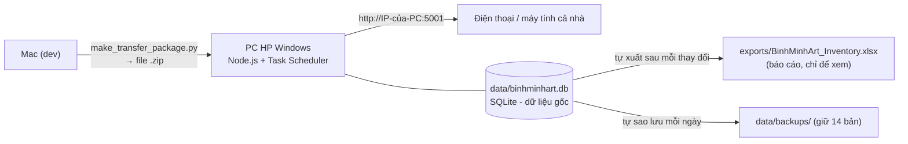

# Triển khai Bình Minh Art lên PC Windows (máy chủ trong nhà)

Mac chỉ dùng để dev. Máy chạy thật là PC HP chạy Windows 10/11, bật liên tục, cả nhà vào qua WiFi.



## Dữ liệu được lưu thế nào

| Thành phần | Vai trò |
|---|---|
| `data/binhminhart.db` | **Cơ sở dữ liệu gốc (SQLite).** Mọi thay đổi trên web ghi vào đây trong một giao dịch: lưu đủ hoặc không lưu gì. Dữ liệu sai kiểu (tình trạng lạ, giá âm hoặc không phải số, mã trùng) bị từ chối kèm thông báo lỗi, không bị tự sửa. |
| `exports/BinhMinhArt_Inventory.xlsx` | **Báo cáo Excel**, tự tạo lại sau mỗi thay đổi. Mở xem/in thoải mái, nhưng **sửa trong file này không đồng bộ ngược**. Muốn nạp dữ liệu từ Excel thì dùng nút **Nhập Excel** trong app. |
| `data/backups/` | Bản sao lưu tự động mỗi ngày (giữ 14 bản gần nhất) và một bản trước mỗi lần "Phục hồi gốc". |
| `data/legacy/` | Dữ liệu Excel/JSON cũ trước khi chuyển sang SQLite (chỉ để lưu trữ, hệ thống không đọc lại). |

Mở file báo cáo bằng Excel **không gây lỗi gì cho hệ thống**. Nếu Excel đang giữ file, báo cáo tạm thời chưa cập nhật được, dữ liệu vẫn an toàn trong SQLite, hệ thống tự thử lại mỗi 30 giây và màn hình cài đặt mạng hiện cảnh báo.

## A. Trên Mac: đóng gói

```bash
cd /Users/mac/Documents/antigravity/BinhMinhArt
python3 scripts/make_transfer_package.py
```

Tạo ra `BinhMinhArt_transfer_YYYYMMDD.zip` (khoảng 280 MB, gồm code, ảnh, cơ sở dữ liệu). Cơ sở dữ liệu được sao bằng cơ chế backup của SQLite nên nhất quán kể cả khi server đang chạy. File này **không** chứa `node_modules`, `dist`, mã QR cũ và cấu hình IP của Mac, vì PC tự tạo lại. Tên file tiếng Việt được chuẩn hóa NFC để Windows đọc đúng.

Copy file zip sang PC bằng USB (zip chứa giá và tên khách hàng, không gửi qua kênh công cộng).

## B. Trên PC HP: cài đặt (làm 1 lần)

1. **Cài Node.js LTS (>= 22.13)**: mở PowerShell gõ `winget install OpenJS.NodeJS.LTS`, hoặc tải từ <https://nodejs.org>. Bản LTS hiện tại đáp ứng yêu cầu này.
2. **Giải nén** file zip vào một thư mục cố định, ví dụ `C:\BinhMinhArt`. Dùng giải nén mặc định của Windows 11, hoặc 7-Zip nếu Windows 10 hiện tên file bị lỗi font.
3. **Mở PowerShell bằng quyền Administrator** (Start → gõ PowerShell → chuột phải → Run as administrator), rồi chạy:
   ```powershell
   cd C:\BinhMinhArt
   powershell -ExecutionPolicy Bypass -File .\deploy\windows\install.ps1
   ```
4. Script tự làm: kiểm tra Node, `npm ci`, build giao diện, mở firewall cổng 5001, tắt chế độ ngủ khi cắm điện, đăng ký tự chạy khi bật máy, khởi động server, kiểm tra server trả lời và in ra địa chỉ cho cả nhà.

Cần internet lúc cài (tải thư viện). Sau đó chạy offline trong mạng nhà vẫn được.

## C. Bắt buộc làm sau khi cài

**Cố định IP của PC.** Mã QR dán trên tranh chứa địa chỉ IP của PC. IP đổi thì mọi QR đã in sẽ hỏng. Vào trang quản trị router, tìm mục "DHCP reservation" / "Address reservation" / "Gán IP tĩnh theo MAC", gán một IP cố định cho PC HP.

Nếu IP vẫn phải đổi: mở app → cài đặt mạng nội bộ, nhập IP mới. Mã QR được tạo lại ở lần lưu dữ liệu kế tiếp, và những tờ QR đã in cần in lại.

## D. Dùng hằng ngày

| Việc | Cách làm |
|---|---|
| Cả nhà vào app | `http://IP-của-PC:5001` trên điện thoại hoặc máy tính cùng WiFi |
| PC khởi động lại / mất điện | Server tự chạy lại, không cần làm gì |
| Xem lỗi | File `C:\BinhMinhArt\logs\server.log` |
| Dừng / chạy tay | Task Scheduler → tác vụ `BinhMinhArt` → End / Run |
| Chạy tay để debug | `deploy\windows\run_server.bat console` |
| Cập nhật phiên bản mới | Copy code mới đè lên (giữ nguyên `data\`, `TRANH\`, `uploads\`), rồi chạy lại `install.ps1` |
| Gỡ cài đặt | `powershell -ExecutionPolicy Bypass -File .\deploy\windows\uninstall.ps1` (không xóa dữ liệu) |

## E. Sao lưu và khôi phục

- **Tự động:** mỗi ngày hệ thống tạo một bản trong `data\backups\`. Đó chỉ là bản trên cùng ổ đĩa, **chưa an toàn nếu ổ cứng hỏng**.
- **Bạn nên làm:** mỗi tuần copy thư mục `data\`, `uploads\`, `TRANH\` và `ĐÃ BÁN\` sang USB hoặc ổ ngoài. Tệp quan trọng nhất là `data\binhminhart.db`.
- **Khôi phục một bản sao lưu:**
  1. Task Scheduler → tác vụ `BinhMinhArt` → End (dừng server).
  2. Xóa `data\binhminhart.db`, `data\binhminhart.db-wal`, `data\binhminhart.db-shm` (nếu có).
  3. Copy bản sao lưu cần khôi phục từ `data\backups\` vào `data\` và đổi tên thành `binhminhart.db`.
  4. Task Scheduler → tác vụ `BinhMinhArt` → Run.
- **Không copy tay `binhminhart.db` khi server đang chạy.** Muốn sao lưu khi đang chạy thì lấy file trong `data\backups\`.

## F. Lưu ý

1. **Chưa có đăng nhập.** Ai vào được địa chỉ này đều xem và sửa được dữ liệu, bao gồm giá và khách hàng. Chỉ dùng trong mạng nhà, không mở cổng ra Internet (không port-forward trên router).
2. Rule firewall mở cổng 5001 cho mọi loại mạng (Private/Public). PC đặt cố định ở nhà nên chấp nhận được. Mang máy ra mạng lạ thì chạy `uninstall.ps1`.
3. Thư viện `sharp` (tạo ảnh thu nhỏ) nằm trong `devDependencies` của `package.json`, nên **không** dùng `npm ci --omit=dev` trên PC. `install.ps1` dùng `npm ci` đầy đủ.
4. Cổng đổi khác 5001 thì phải sửa ở 3 nơi: `$Port` trong `install.ps1` và `uninstall.ps1`, và đặt biến môi trường `PORT` cho server.
5. Dữ liệu trên Mac và PC là hai bản độc lập sau khi chuyển. Từ lúc PC chạy thật, mọi chỉnh sửa nên làm trên PC để tránh lệch dữ liệu.
6. Chỉ chạy **một** server cho mỗi cơ sở dữ liệu. Không mở cùng `binhminhart.db` bằng hai server cùng lúc.
7. Cơ sở dữ liệu dùng SQLite tích hợp sẵn của Node.js (`node:sqlite`, còn ghi chú "experimental" trong Node, nên log có một dòng cảnh báo lúc khởi động và `package.json` ghi rõ phiên bản Node tối thiểu). File `.db` là SQLite chuẩn, mở được bằng DB Browser for SQLite. Toàn bộ mã dùng SQLite nằm trong một file `server/sqliteStore.js`, nên nếu cần đổi thư viện sau này chỉ phải sửa file đó.
